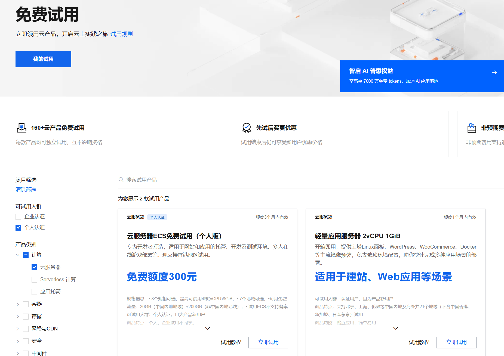
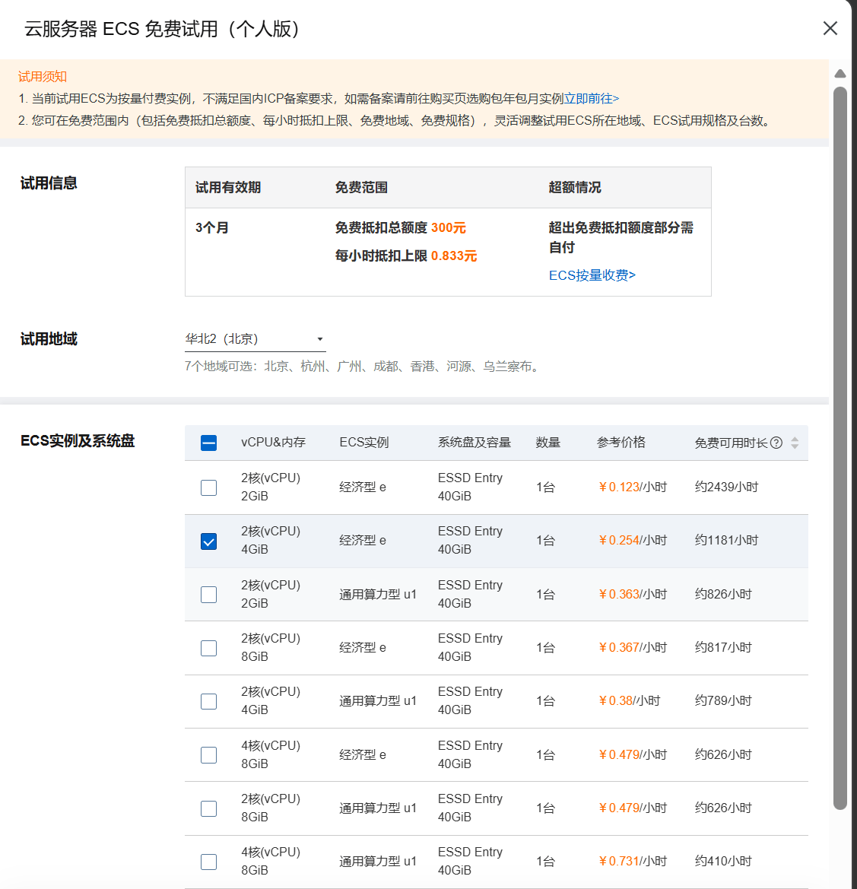
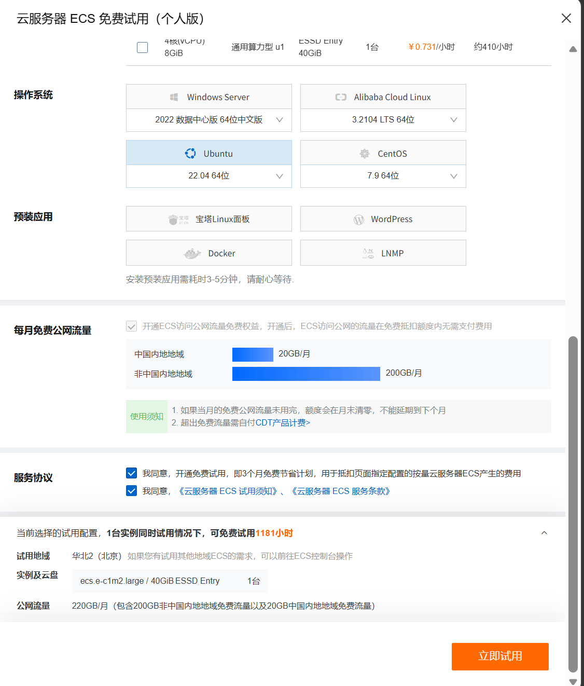
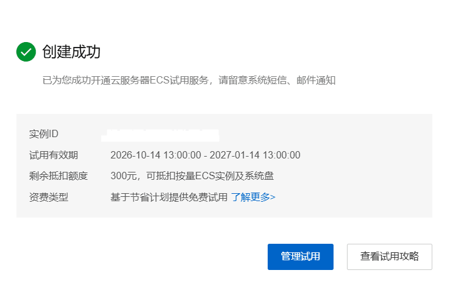
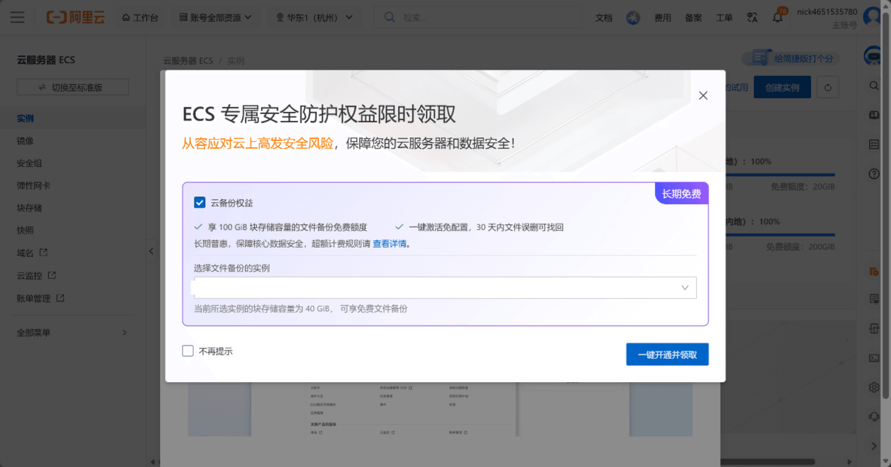
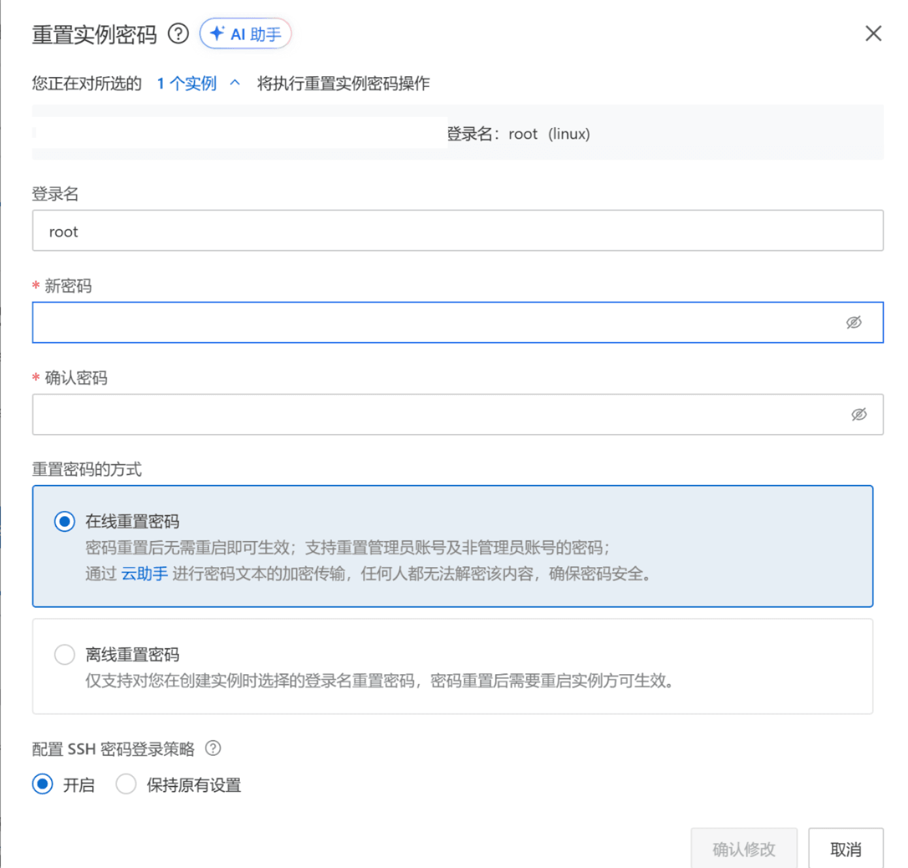
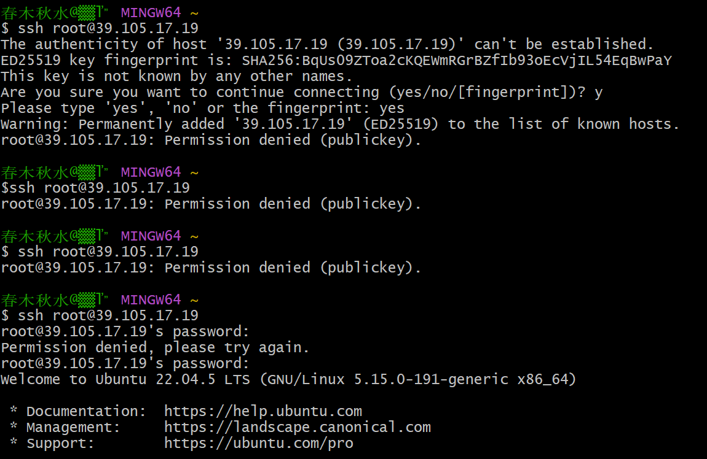
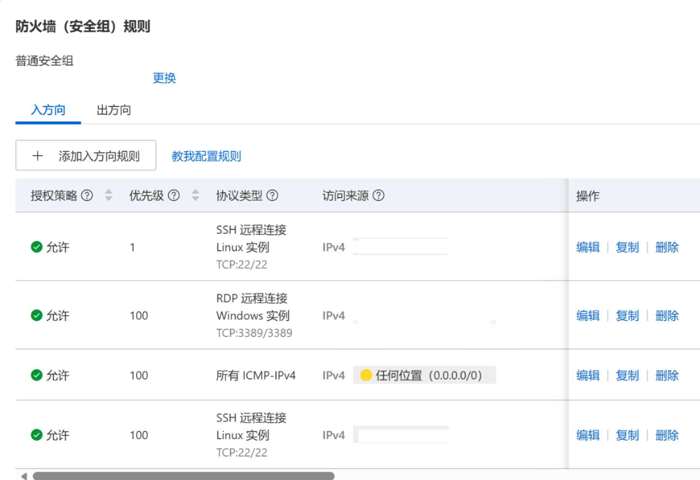
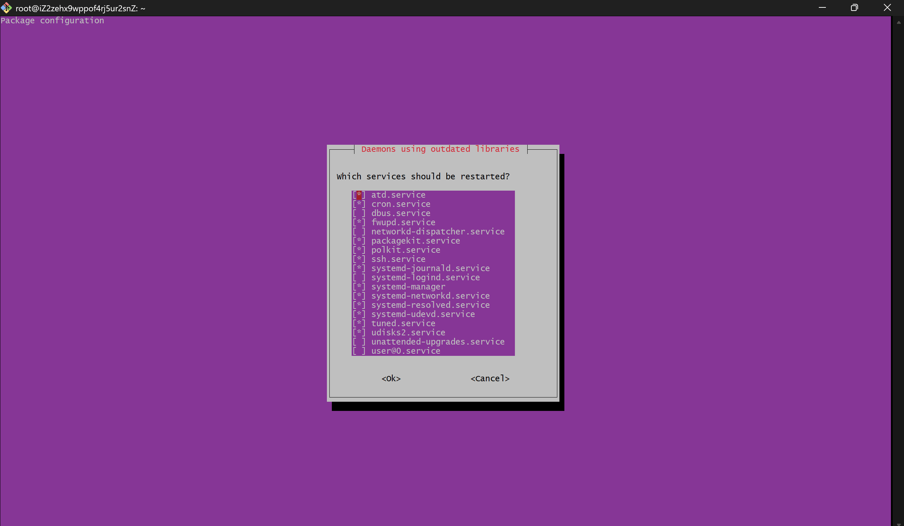
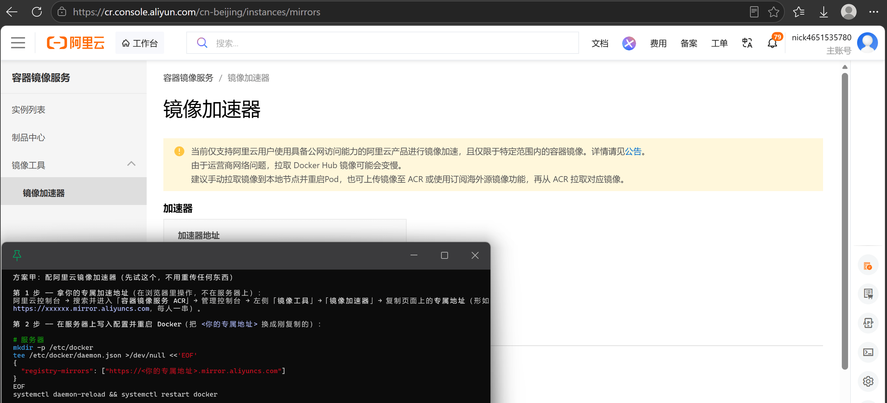

# 开通阿里云服务器并进行简单的部署

---

> 背景说明: 做完一个练习项目, 想放到服务器上面, 一方面开通自己的服务器、体验下基础的线上部署，一方面感觉比较好玩儿

1. 来到<u>[官方云服务器试用界面](https://free.aliyun.com/?spm=5176.32270579.J_RIoiIhIPOvZIGUchbo3zM.2.6f853aa8PLsKhF&product=1351&crowd)</u>

    

2. 选择服务器类型
    * 个人选的 `云服务器ECS免费试用（个人版）`, 额度更多、内存更多
    * `轻量应用服务器 2vCPU 1GiB` 内存太少怕带不动

3. 选择配置
    * 2核4G

    

    * 操作系统选 Ubuntu, 我这里忘了切换版本，用的默认的 22LTS, 读者在选择的时候可以看下下拉列表有没有 24LTS
    * 这里没有预装应用，全部手动命令行装需要的东西

    

4. 开通云服务器

    

    * 这里有个备份权益，100GB以内免费备份，因为我这服务器只有 40G, 所以我选择了开通

    

5. 进去过后设置密码（点击重置密码），否则本地 ssh 连不上服务器

    

6. 然后打开 git bash 连接服务器
    * 没有装 git 的话可以参考这篇文章 → <u>[git 安装](/技术教程类/开发工具&插件/Git/安装GitForWindow.md)</u>
    * 当然也可以试试网页端的 `Workbench远程连接`

    ```shell
    # 注意用英文输入法、首尾尽量不带多余的空格
    # 粘贴用鼠标右键 paste, ctrl + shift + v 没有效果
    ssh root@服务器的公网IP
    # 复制异常信息用 ctrl + shift + c 或者选中后鼠标右键 copy
    ```

    * 然后输入密码登录

    

7. 登录成功后去网页端控制台设置 SSH 的 IP 白名单，避免自己的服务器被其他人用 ssh 控制[doge]
    * 在 `网络与安全组` → 防火墙/安全组规则那一块，点击编辑，把IP改成自己的
      - 比如 `123.123.123.123/32` 只匹配 `123.123.123.123` 这一个IP
      - `123.123.123.123/24` 匹配 `123.123.123.0` ~ `123.123.123.255` 共 2^8 个 IP，用于处理第 4 段 IP 经常变的情况
      - ...
      - 避免写 `/0`, 它会匹配 `0.0.0.0` ~ `255.255.255.255` 共 2^32 个 IP( 所有 IP )

    

    * 如果需要记录多个 IP，可以点击 `添加方向规则` 把自己常用的 IP 记录上去

8. 更新软件包

    ```shell
    # 看看有没有装包管理器, 通常是有的
    apt --version
    
    # 更新
    # 他这里不需要 sudo, 应该是因为 root 用户已经有了最大权限, 如果遇到权限问题可以试下在命令最前面加 sudo
    # 刷新软件包列表，看看有哪些新版本
    apt update
    # 升级已安装的软件包，-y 表示自动确认
    apt upgrade -y
    ```

    * 遇到一个粉色界面，好像是升级后需要重启的服务，直接 Enter 确认就行

    

9. 修改时区

    ```shell
    # 把系统时区改成 亚洲/上海
    timedatectl set-timezone Asia/Shanghai
    # 现在应该会输出当前时间
    timedatectl
    ```

10. 然后装 Docker

    ```shell
    # 官方脚本：安装 Docker Engine 与 Compose v2 插件
    curl -fsSL https://get.docker.com | sh
    # 开机自启并立即启动；重启后容器自动恢复
    systemctl enable --now docker
    # 验证两条命令均有版本输出
    docker --version && docker compose version
    ```
    
11. 配镜像加速器, 主要用于拉取镜像, **如果选择本地上传所有镜像就跳过这步**
    * 阿里云网站搜索 `容器镜像服务` , 来到 <u>[镜像加速器](https://cr.console.aliyun.com/cn-beijing/instances/mirrors)</u>界面
    * 复制自己的加速器地址

    

    * 创建镜像加速器配置

    ```shell
    mkdir -p /etc/docker
    cat > /etc/docker/daemon.json <<-'EOF'
    {
      "registry-mirrors": ["https://你的专属地址.mirror.aliyuncs.com"]
    }
    EOF
    ```

    * 重启 Docker

    ```shell
    systemctl daemon-reload
    systemctl restart docker
    
    # 验证配置是否生效, 预期出现加速器地址
    docker info | grep -A1 "Registry Mirrors"
    # 这里的 -A1 是输出 "Registry Mirrors" 标题和它后面那一行
    ```

12. 拉取项目需要的基础设施( **如果选择本地上传所有镜像就跳过这步** )
    * 不过我这里报错 NotFound, AI 分析可能是加速器不再去 Docker Hub 拉镜像, 所以我改为本地上传基础设施

    ```shell
    docker pull redis:7-alpine
    docker pull mysql:8.0
    # ...
    Error response from daemon: failed to resolve reference "docker.io/library/redis:7-alpine": docker.io/library/redis:7-alpine: not found
    ```

13. 在本地把前后端服务、基础设施一起打成 tar.gz，新开一个 git bash 把本地压缩包上传到服务器
    * 备注: 云部署前建议现在本地部署跑通

    ```shell
    cd 本地存放压缩包的目录
    scp 压缩包.tar.gz root@公网IP:/opt/
    ```

    * 上传 docker-compose 编排文件、nginx 配置、`.env` 环境变量、基础 sql 数据、相关脚本(导入数据、加载镜像等等)
14. 在 git bash 回到服务端，跟着 AI 的命令加载镜像、启动容器、编排服务、检查状态

    ```shell
    # 看容器状态，等他们从 starting 变成 healthy/running
    docker ps
    # 查看后端日志
    docker logs --tail 100 project-backend 
    # 应该会返回 200 和 html 文本
    curl localhost:前端服务的端口号
    ```

15. 然后去服务器控制台 → `网络与安全组` → 入方向, 添加规则, 允许任意 IP( `0.0.0.0/0` )访问前端端口，再拿给同学试试，可以成功用 `公网IP:端口号` 访问前端
16. 节省额度??
    * 看到控制台提示 `节省停机模式`, 问下 AI 知道这个模式只在停机的时候有用，如果需要一直挂起服务、就用不到他，想省额度的话直接停机就行
    * 对于后端的定时任务，为了保证功能完整就没取消或者延长时间，看后台静止的时候消耗额度大概也就 `0.127 元/小时`
    * 等额度消耗速度快的时候再来看吧...
17. 附上某外卖项目的仓库、访问地址, 大佬轻喷
    * <u>[仓库传送门](https://github.com/existed-name/sky-takeout-backend)</u>
    * 管理端前端 → <u>http://39.105.17.19:80</u>
    * 用户端前端 → <u>http://39.105.17.19:8082</u>

---

> 往期文章  
> [开通阿里云对象存储服务](/技术教程类/云服务/对象存储服务/开通阿里云对象存储服务.md)


