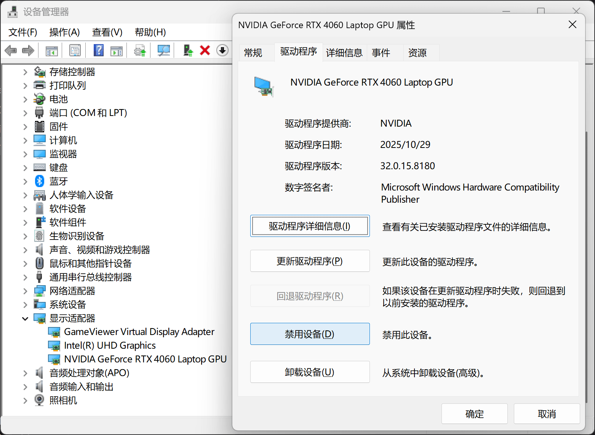
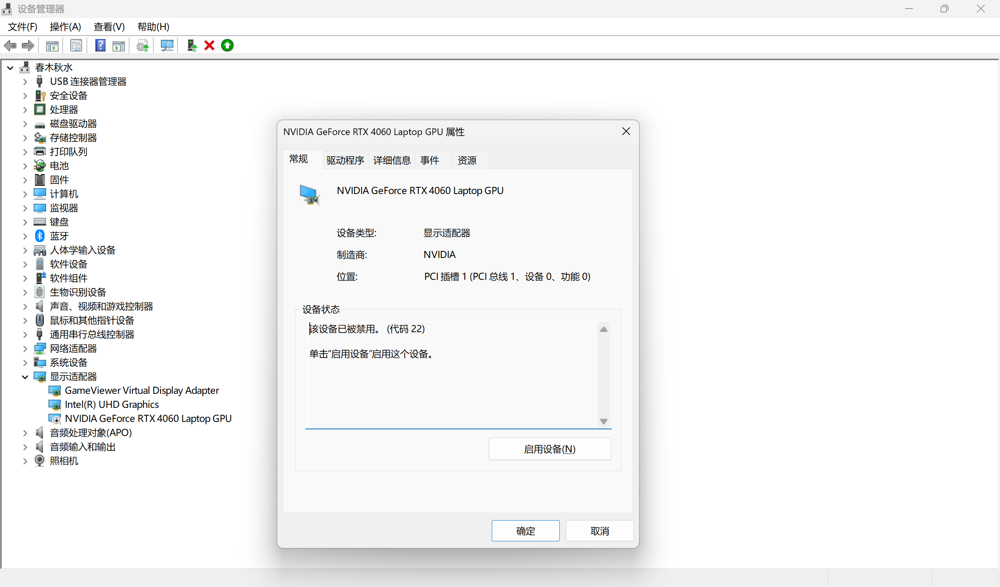
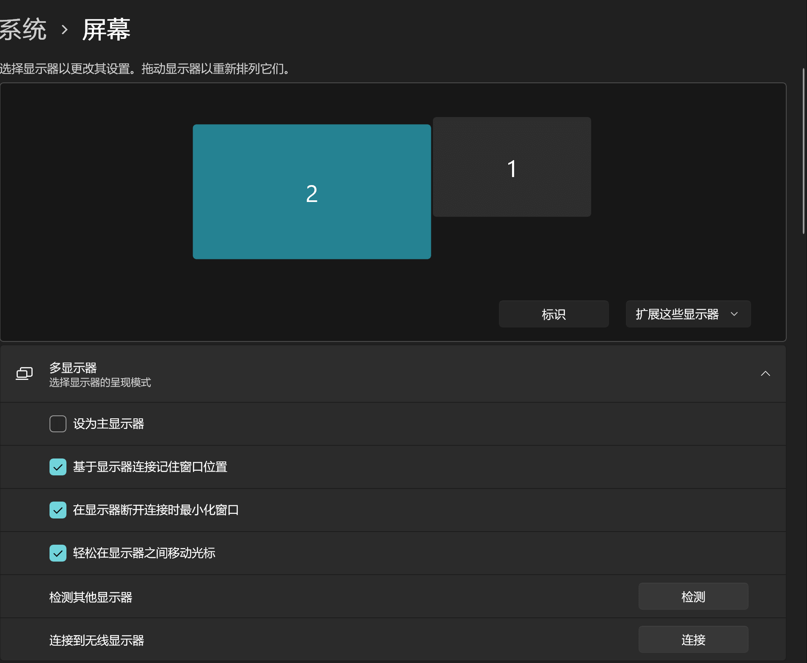

# 解决笔记本电脑连不上显示屏的问题

---

---

## 配置

* win11 笔记本
* 通用的 HDMI 数据转接线，把笔记本的信息输出到显示屏上面

## 问题描述

* 窗口太多、电脑屏幕不够看，于是想放到显示屏上面
* 但是对于一块插上电源线的显示屏，我的笔记本连上它后，一直无信号
* 反复重启显示屏、电脑，把数据线从显示屏的 HDMI 1 号接口换到 2 号接口，换新的数据线、甚至再换块显示屏，都没用
* 而同学就可以直接正常使用
* 两三个月前试着解决一次，没成功，这次终于解决了

## 结论(对于我的情况)

* win + x → 点击进入 `设备管理器`

    

* 看到 `显示适配器` 目录下的 `NVIDIA GeForce ...`（我这里是 `NVIDIA GeForce RTX 4060 Laptop GPU`)
* 右键 → `属性` → `驱动程序` → `启用设备`

    

* 然后就可以正常输出信号到显示屏了，屏幕也会更流畅（除非内存不够用
* 由于每个电脑情况可能不一样，如果你的电脑用了我这个方法后还是不行，可以参考下面的[排查过程](#排查过程)、跟ai一起排查

## 排查过程

* 把电脑型号、问题描述、尝试过的解决方法整理一下，发给 AI，提醒她让我补充信息
* 根据 AI 的提示 
  - 补充显示屏的具体型号
  - 设置 → 系统 → 屏幕 → 找到 `多显示器` → `检测其他显示器`, 判定为 `无法找到其他显示器`
  - 这个操作可以用来判断电脑有没有识别到连接的设备
  - win + p 修改电脑的 `投影`
* 然后尝试更换显示屏，并把另一块显示屏的具体型号、我电脑处理器信息（win + r → 输入 `msinfo32` → 看到界面的 `处理器` 那一栏）、`设备管理器-显示适配器` 文件夹里面的内容发给他
* 这个时候就出现转机了，她提出了多种尝试方法，其中 1 个是看看显卡是不是被禁用了，启用后看看
* 于是我尝试启用显卡，发现启用后、不需要重启显示屏/电脑，显示屏就直接亮了, 算是成功了

    

## 显示屏使用操作

* 首先需要电源线，跟电视机一样
* 然后是数据转接线（如果是纯无线的显示屏就不需要了）
  - HDMI、DP、还有 1 种圆柱形比较细的插头不知道是什么类型
  - 我电脑只有一个 HDMI 口，不过也够用了
* 似乎高端玩家会玩弄电脑的显卡来支持数据转接，我这里就跳过了（对硬件一脸懵逼）
* 连上显示屏后，win + p 打开 `投影` 选项，
* `仅第二屏幕` 是把电脑屏幕转移到显示屏上面，一般用于习惯一个屏幕、只是想换个大屏幕的同学
* `复制` 就相当于投影了，电脑屏幕、显示屏都放一样的内容
* 我一般用 `拓展`，这样就可以用 2 块屏幕放多个窗口、不用切来切去

    

* 点击 `拓展` 后，设置 → 系统 → 屏幕 → 找到 `多显示器` → 看到这里的显示器排列

    

* 1 号（更小的那个）是笔记本，2 号（更大的那个）是显示屏，我这里把 2 号移到 1 号左边，再（从物理位置上）把显示屏移到笔记本左边，这样鼠标左移的时候，就可以从笔记本走到显示屏上面
* 这样，显示屏放 ai 对话、1 个编译器窗口，我电脑上再放 1 个编译器窗口、自己写会儿代码/文档，然后有情况就往左边看看 ai 怎么样了，不用把窗口切来切去

